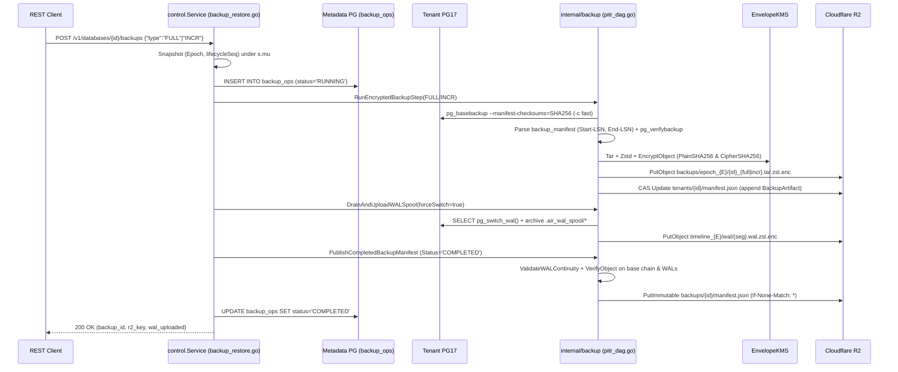

# Backup, Manifest Verification & PITR Restore Architecture

AIR implements a defense-in-depth backup and Point-in-Time Recovery (PITR) architecture in [internal/backup](file:///workspaces/air/internal/backup) and [internal/control/backup_restore.go](file:///workspaces/air/internal/control/backup_restore.go).

---

## 1. End-to-End Backup Pipeline

### Backup Consistency Guarantees
1. **PostgreSQL Checkpoint & Manifest Verification**:
   - `RunEncryptedBackupStep` invokes `pg_basebackup` with `--checkpoint=fast` and `--manifest-checksums=SHA256`, then immediately runs `pg_verifybackup` on the local base backup directory before archiving.
   - `parsePGBackupManifestLSNs` extracts the exact `Start-LSN` and `End-LSN` from PostgreSQL's `backup_manifest` so the backup's minimum recovery consistency point (`ConsistencyLSN`) is anchored to PostgreSQL's own backup end LSN.
2. **Post-Backup WAL Switch & Drain**:
   - Immediately after `RunEncryptedBackupStep`, `backupTenantToR2` runs `DrainAndUploadWALSpool(..., true)` to force a WAL segment switch (`pg_switch_wal()`) and upload every WAL segment needed to reach `ConsistencyLSN`.
   - The drain syncs the updated WAL upload manifest and its parent directory before removing the local segment.
3. **Immutable Manifest Publication (`PublishCompletedBackupManifest`)**:
   - A `BackupManifest` is only published after:
     - Every base/incremental archive object in the chain is verified in R2 (`Store.VerifyObject`),
     - Every WAL segment covering `[WALStartLSN, WALEndLSN]` passes `ValidateWALContinuity` and `Store.VerifyObject`, and
     - All referenced Pageserver CAU layers (when Pageserver is enabled) are verified in R2.
   - The manifest is written to `tenants/{tenant_id}/backups/{backup_id}/manifest.json` using `If-None-Match: "*"` (`PutImmutable`), ensuring published manifests can never be mutated.

---

## 2. Checksum Architecture: Plaintext vs. Ciphertext Separation

Every encrypted backup and WAL object tracks two distinct SHA-256 digests:

| Field | Computed Over | Stored In | Verified When |
| :--- | :--- | :--- | :--- |
| **`CipherSHA256`** | AES-256-GCM ciphertext uploaded to R2 | `BackupRef.CipherSHA256`, `WALRef.CipherSHA256`, `BackupArtifact.CipherSHA256`, S3 header `x-amz-meta-air-cipher-sha256` | `VerifyBackup` / `Store.VerifyObject` via `HeadObject` without downloading/decrypting the full object |
| **`PlainSHA256`** | Raw unencrypted `.tar.zst` archive or raw 16 MiB WAL segment | `BackupRef.PlainSHA256`, `WALRef.SHA256`, `WALSegmentArtifact.PlainSHA256`, S3 header `x-amz-meta-air-plain-sha256` | `StagePITRRestore` after KMS decryption and Zstd decompression |

---

## 3. Backup Verification (`VerifyDatabaseBackup`)

Calling `POST /v1/databases/{id}/backups/{backup_id}/verify` executes `backup.VerifyBackup`:
1. Loads `tenants/{tenant_id}/backups/{backup_id}/manifest.json` from R2.
2. Validates manifest structural fields, status (`Status == COMPLETED`), LSN formatting, and `ConsistencyLSN <= WALEndLSN` (`BackupManifest.Validate()`).
3. Verifies `ValidateWALContinuity(m.WALSegments, m.WALStartLSN, m.WALEndLSN)` across all referenced 24-hex WAL segments.
4. Calls `Store.VerifyObject` (`HeadObject`) on the base backup object, every parent incremental object in `ParentChain`, every WAL segment in `WALSegments`, and every Pageserver layer in `LayerRefs`, verifying exact object existence, size, and `CipherSHA256`.

---

## 4. Point-in-Time Recovery (`StagePITRRestore` & `RestoreDatabaseWithOptions`)

### 4.1 Supported Recovery Targets (`RecoveryTarget`)
- **`latest` (`RecoveryTargetLatest`)**: Replays all archived WAL segments available for the timeline and promotes immediately.
- **`target_lsn` (`RecoveryTargetLSN`)**: Configures PostgreSQL `recovery_target_lsn = '<LSN>'` and `recovery_target_inclusive = true`. Pre-validated before staging against `[ConsistencyLSN, effectiveWALEndLSN]` (`ErrInvalidRecoveryTarget` on malformed LSN, `ErrTargetBeforeBaseBackup` if `< ConsistencyLSN`, `ErrTargetAfterAvailableWAL` if `> effectiveWALEndLSN`).
- **`target_time` (`RecoveryTargetTimestamp`)**: Configures PostgreSQL `recovery_target_time = '<RFC3339>'` and `recovery_target_inclusive = true`.

### 4.2 Post-Backup WAL Discovery (`buildRestoreWALArtifacts`)
When a backup `B` is taken at time $T_0$ and additional transactions are committed and archived via `{"type":"WAL"}` at $T_1 > T_0$, `RestoreDatabaseWithOptions` combines:
1. `B.WALSegments` (from `B`'s immutable `BackupManifest`),
2. Subsequent WAL segments recorded in the local `wal_upload_manifest.json` for the same epoch, and
3. Subsequent WAL segments recorded in the R2 `TenantFenceManifest.WALSegments`.

This produces a unified `pitrManifest` whose `WALEndLSN` extends through $T_1$, allowing `target_lsn` or `target_time` to target any point in $[B.\text{ConsistencyLSN}, T_1]$.

### 4.3 Restore Modes
1. **Validation Restore (`new_tenant_id == ""`)**:
   - Extracts the backup chain into an isolated staging directory (`<data-dir>/backups/<tenant_id>/pitr_restore_<nanos>`), runs `pg_combinebackup` (for incremental chains) and `pg_verifybackup`, decrypts/decompresses/verifies all WAL segments, replays WAL to the target in a temporary PostgreSQL 17 instance, runs a fixed `SELECT 1;` connectivity check and `pg_amcheck`, records `COMPLETED` in `restore_ops`, and deletes the staging directory.
2. **Full Restore Into New Isolated Tenant (`new_tenant_id != ""`)**:
   - Performs the complete staging PITR and verification above with `KeepStaging: true` and `RenameDatabaseFrom: sourceTenantID, RenameDatabaseTo: newTenantID`.
   - Generates a fresh KMS DEK (`epoch = 1`) and `app_user` password for `new_tenant_id`.
   - Moves the verified `combined_pgdata` into `<data-dir>/pgdata/<new_tenant_id>`, configures `air_smgr` and PostgreSQL port/socket settings, fences `epoch = 1` in R2, starts the new PostgreSQL 17 instance, and registers `new_tenant_id` in `clusters` as `ACTIVE`.

Run application-specific verification on the restored tenant through the gateway using the restored tenant credentials.
