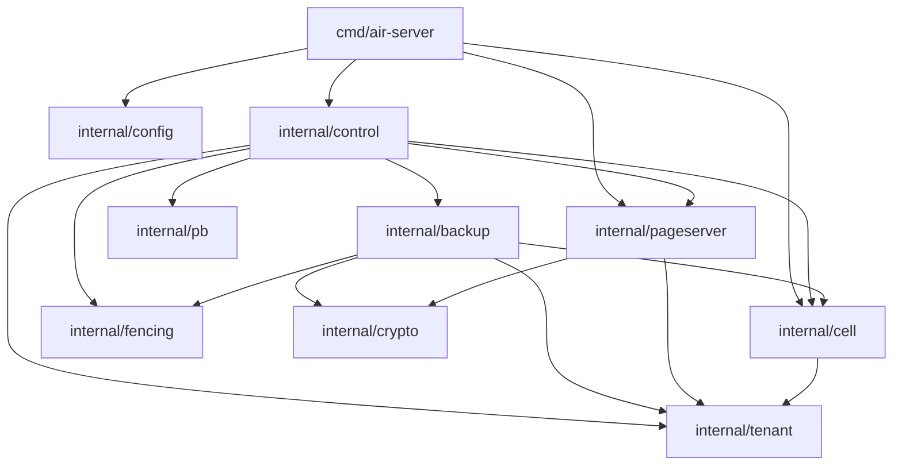
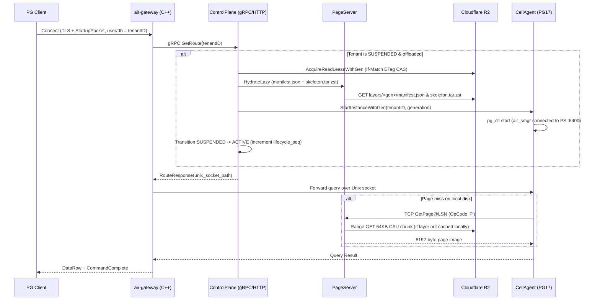
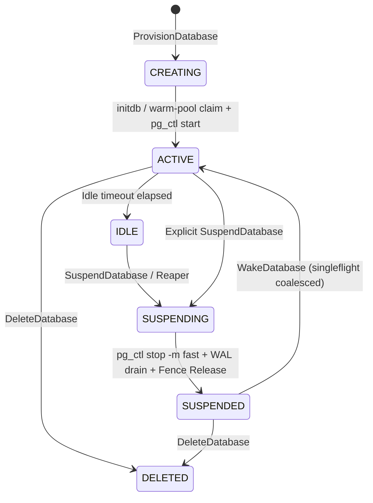
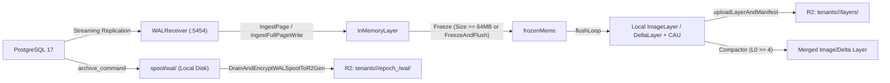

# AIR Codebase Architecture Map

This document maps the components, package dependencies, runtime execution flows, data flows, storage interactions, and concurrency invariants across the AIR repository.

---

## 1. Component Responsibilities

| Component / Package | Primary Files | Responsibilities |
| :--- | :--- | :--- |
| **Server Entrypoint** (`cmd/air-server`) | [main.go](file:///workspaces/air/cmd/air-server/main.go) | Bootstraps configuration, initializes Cell Agent, Page Server, WAL Receiver, and Control Plane, binds HTTP (`:8080`), gRPC (`:9001`), Page Server TCP (`:6400`), and WAL Receiver (`:5454`), and coordinates graceful shutdown. |
| **Read Engine Entrypoint** (`cmd/air-read-engine`) | [main.go](file:///workspaces/air/cmd/air-read-engine/main.go) | Standalone daemon managing lightweight read-only PG17 instances (`air_ro.so`, `pg_basebackup` hot standby or `air_smgr.read_only`) with HTTP control on `:8082`. |
| **Configuration** (`internal/config`) | [config.go](file:///workspaces/air/internal/config/config.go) | Loads and validates environment variables (`AIR_*`), runtime flags, R2 credentials, ports, and timeouts. |
| **Tenant Identifiers** (`internal/tenant`) | [validate.go](file:///workspaces/air/internal/tenant/validate.go) | Validates tenant IDs (`^[a-zA-Z0-9_-]{1,64}$`) and generation tokens against path traversal, null bytes, and reserved names. |
| **Envelope Cryptography** (`internal/crypto`) | [envelope.go](file:///workspaces/air/internal/crypto/envelope.go) | Derives per-tenant 256-bit Data Encryption Keys (DEKs) from the Master Key Encryption Key (`AIR_MASTER_KEK_HEX`) via HKDF-SHA256 (`air-pitr-envelope-v1`) and performs AES-256-GCM authenticated encryption/decryption (`AIR1` wire header). |
| **R2 CAS Fencing** (`internal/fencing`) | [r2_cas.go](file:///workspaces/air/internal/fencing/r2_cas.go) | Implements split-brain prevention using Cloudflare R2 conditional writes (`If-Match: <ETag>` / `If-None-Match: "*"`) on `tenants/<id>/<gen>/manifest.json`. Tracks `current_epoch`, `state`, `backups`, and `wal_segments`. |
| **Backup, WAL & PITR** (`internal/backup`) | [pitr_dag.go](file:///workspaces/air/internal/backup/pitr_dag.go), [manifest.go](file:///workspaces/air/internal/backup/manifest.go), [store.go](file:///workspaces/air/internal/backup/store.go), [lsn.go](file:///workspaces/air/internal/backup/lsn.go), [recovery.go](file:///workspaces/air/internal/backup/recovery.go), [tar_safe.go](file:///workspaces/air/internal/backup/tar_safe.go), [verify.go](file:///workspaces/air/internal/backup/verify.go) | Executes full and incremental (`FULL`/`INCR`) tar+zstd+AES-GCM backups, drains active and stopped WAL spools to R2, seals and publishes immutable `BackupManifest` objects, verifies backup chains and checksums, and stages/replays PostgreSQL 17 PITR (`target_lsn`, `target_time`, `latest`). |
| **Cell Agent** (`internal/cell`) | [agent.go](file:///workspaces/air/internal/cell/agent.go), [process.go](file:///workspaces/air/internal/cell/process.go), [warm_pool.go](file:///workspaces/air/internal/cell/warm_pool.go) | Manages local PostgreSQL 17 instances (`initdb`, `pg_ctl`, Unix-domain socket readiness, cgroup v2 memory limits, warm pool pre-initialization, `archive_command` WAL spooling, and `air_smgr` GUC wiring). |
| **Page Server** (`internal/pageserver`) | [server.go](file:///workspaces/air/internal/pageserver/server.go), [layers.go](file:///workspaces/air/internal/pageserver/layers.go), [cau.go](file:///workspaces/air/internal/pageserver/cau.go), [compactor.go](file:///workspaces/air/internal/pageserver/compactor.go), [readpath.go](file:///workspaces/air/internal/pageserver/readpath.go), [skeleton.go](file:///workspaces/air/internal/pageserver/skeleton.go), [walreceiver.go](file:///workspaces/air/internal/pageserver/walreceiver.go) | Disaggregated MVCC page store serving `GetPage@LSN`, `GetRelSize`, and `GetSlruSegment` over a custom binary TCP protocol; ingests WAL via PostgreSQL streaming replication (`pglogrepl`); flushes `InMemoryLayer` to immutable `ImageLayer`/`DeltaLayer` files; bundles layers into 64KB CAUs in R2; compacts L0 layers; and extracts skeleton metadata for instant cold wake. |
| **Control Plane** (`internal/control`) | [control.go](file:///workspaces/air/internal/control/control.go), [http.go](file:///workspaces/air/internal/control/http.go), [grpc.go](file:///workspaces/air/internal/control/grpc.go), [events.go](file:///workspaces/air/internal/control/events.go) | Orchestrates tenant lifecycle state machine, singleflight wake coalescing, idle reaper, cold offload worker (`offload_jobs`), backup/PITR/restore APIs, SSE lifecycle events, and gRPC `GetRoute` for the C++ gateway. |
| **PostgreSQL SMGR Extension** (`extensions/air_smgr`) | [air_smgr.c](file:///workspaces/air/extensions/air_smgr/air_smgr.c), [protocol.h](file:///workspaces/air/extensions/air_smgr/protocol.h) | PostgreSQL 17 C extension hooking `smgr_readv`/`smgr_nblocks` to lazily fetch evicted 8KB heap/index pages from the Page Server over TCP (`127.0.0.1:6400`) and cache them locally. |
| **Read-Only Guard Extension** (`extensions/air_ro`) | [air_ro.c](file:///workspaces/air/extensions/air_ro/air_ro.c) | PostgreSQL 17 C extension enforcing strict read-only execution (`ExecutorStart_hook`, `ProcessUtility_hook`, `object_access_hook`) when `air_ro.enabled = on`. |
| **Read-Only Storage Adapter** (`internal/readadapter`) | [adapter.go](file:///workspaces/air/internal/readadapter/adapter.go), [pgpage.go](file:///workspaces/air/internal/readadapter/pgpage.go) | Snapshot-pinned, generation-fenced read-only storage adapter over `Pageserver` plus PG17 physical heap/B-tree page validator & tuple decoder. |
| **C++ Wire Gateway** (`gateway/`) | [main.cpp](file:///workspaces/air/gateway/src/main.cpp), [pooler.cpp](file:///workspaces/air/gateway/src/pooler.cpp), [sql_router.cpp](file:///workspaces/air/gateway/src/pg/sql_router.cpp), [discovery.cpp](file:///workspaces/air/gateway/src/discovery.cpp) | Standalone C++20 proxy accepting external PostgreSQL connections (`:5432`), routing read-only SQL to Read Engine (with LSN causal-lag fallback) and writes to Cell via gRPC `GetTenantRoute`. |

---

## 2. Package Dependency Graph

No circular dependencies exist in the Go module (`github.com/Mahadi-rsio/air`). The dependency hierarchy is strictly layered:

---

## 3. Runtime Execution & Data Flow

### 3.1 Request & Wake Path (Scale-to-Zero Cold Start)

### 3.2 Tenant Lifecycle State Machine

### 3.3 WAL Ingestion, Layer Creation, Compaction & Offload Flow

---

## 4. Storage & R2 Key Namespace

All object keys in Cloudflare R2 are generation-scoped under `tenants/<tenant_id>/<generation>/` to prevent stale background writers or reincarnated tenants with the same name from reading or corrupting another generation's state:

| Object Category | R2 Key Pattern | Mutability & Integrity |
| :--- | :--- | :--- |
| **Fence Manifest** | `tenants/<tenant>/<gen>/manifest.json` | Mutable only via HTTP `If-Match` ETag CAS (`internal/fencing`). |
| **Layer Manifest** | `tenants/<tenant>/<gen>/layers/manifest.json` | Atomic single-PUT replacement with monotonic `Version` and `LifecycleSeq` check (`internal/pageserver`). |
| **Skeleton Archive** | `tenants/<tenant>/<gen>/layers/skeleton.tar.zst` | Immutable per offload sequence; contains `pg_control`, catalogs, SLRU, and `PG_VERSION`. |
| **Page Layers & CAUs** | `tenants/<tenant>/<gen>/layers/<layer_file>` | Immutable (`Cache-Control: immutable`), AES-256-GCM encrypted (`AIR1`) when KEK is configured. |
| **Backup Manifest** | `tenants/<tenant>/<gen>/backups/<backup_id>/manifest.json` | Immutable (`If-None-Match: "*"`), sealed with `ManifestSHA256` (`internal/backup`). |
| **Backup Base Archive** | `tenants/<tenant>/<gen>/backups/<backup_id>/base.tar.zst.enc` | Immutable, tar + zstd + AES-256-GCM encrypted (`AIR1`) with plaintext and ciphertext SHA-256. |
| **Archived WAL Segment** | `tenants/<tenant>/<gen>/epoch_<epoch>/wal/<seg>.zst.enc` | Immutable per epoch/segment, zstd + AES-256-GCM encrypted (`AIR1`). |

---

## 5. PostgreSQL 17 Integration Boundaries

1. **Process Supervision (`internal/cell`)**:
   - Invokes `initdb`, `pg_ctl`, `pg_isready`, and `pg_amcheck` directly via `/usr/lib/postgresql/17/bin`.
   - Configures `unix_socket_directories`, `shared_preload_libraries = 'air_smgr'`, `air_smgr.pageserver_conn = '127.0.0.1:6400'`, `air_smgr.tenant_id`, and `archive_command = 'cp "%p" ".../spool/wal/%f"'`.
2. **Custom SMGR (`extensions/air_smgr`)**:
   - Registers custom `f_smgr` hooks (`air_mdreadv`, `air_mdwritev`, `air_mdextend`, `air_mdnblocks`).
   - If a requested 8KB block is missing or truncated locally (e.g., after lazy skeleton hydration), `air_mdreadv` sends a 45-byte binary `GetPage@LSN` request (`'P'`) to the Page Server, validates the response, writes the page to local disk for future hits, and returns it to PostgreSQL's buffer manager.
3. **PITR Recovery (`internal/backup`)**:
   - Extracts the `FULL` -> `INCR` tar chain safely via `ExtractTarZstSafe`, stages decrypted WAL segments into `restore_wal/`, writes `restore_command` and `recovery_target_lsn` / `recovery_target_time` into `postgresql.auto.conf`, creates `recovery.signal`, and runs `postgres` or `pg_ctl start` until `pg_is_in_recovery() = false`, followed by `pg_amcheck`.

---

## 6. Concurrency & Lock Ordering Boundaries

### 6.1 Control Plane (`internal/control`)

- **`provMu` (`sync.Mutex`)**: Protects in-process provisioning reservation maps (`provInFlight`, `idempStore`). Acquired briefly for memory lookups; never held across PostgreSQL `initdb`, `pg_ctl`, or R2 network I/O.
- **`tenantLocks` (`sync.Map` of `*sync.Mutex`)**: Per-tenant lifecycle mutex (`lockTenantLifecycle(tenantID)`). Serializes `SuspendDatabase`, `WakeDatabase`, `DeleteDatabase`, and `BackupDatabase` for a single tenant without blocking other tenants.
- **`wakeGroup` (`singleflight.Group`)**: Coalesces concurrent wake requests (e.g., 100 simultaneous connections to a suspended tenant) into a single execution of `wakeDatabaseInternal`.
- **`lifecycle_seq` & `generation`**: Every state transition increments `lifecycle_seq` in the control-plane database. Long-running background offload jobs verify `(generation, lifecycle_seq)` before and after R2 uploads and abort if the tenant woke up or was re-provisioned mid-flight.

### 6.2 Page Server (`internal/pageserver`)

Strict lock hierarchy per `Timeline`:
1. **`flushMu` (`sync.Mutex`)**: Serializes `FreezeAndFlush` operations so concurrent checkpoint/suspend flush callers wait until all frozen layers are written to disk and uploaded to R2.
2. **`compactMu` (`sync.Mutex`)**: Ensures at most one compaction pass runs on a timeline at a time.
3. **`manifestMu` (`sync.Mutex`)**: Serializes local and R2 `layers/manifest.json` publication and monotonic `manifestVersion` increments.
4. **`Timeline.mu` (`sync.RWMutex`)**: Protects in-memory pointers (`mem`, `frozenMems`, `layers`, `lastRecordLSN`, `deleted`, `lifecycleSeq`).
   - **Invariant**: `Timeline.mu` is **never** held across disk fsyncs or R2 network I/O. Flush and compaction snapshot the layer pointers under `Timeline.mu`, release `Timeline.mu` to perform disk/R2 I/O, and re-acquire `Timeline.mu` briefly to swap `frozenMems`/`layers`.
5. **`InMemoryLayer.mu` (`sync.RWMutex`)**: Leaf lock protecting the per-block version map inside an active or frozen in-memory layer.

---

## 7. Architectural Audit Findings (Smells & Remediations for Phase 13.1)

1. **Oversized Monolithic File (`internal/control/control.go` — 2,445 lines)**:
   - Mixes schema migrations, tenant provisioning, suspend/wake lifecycle, cold-offload background worker, R2 fencing helpers, and backup/PITR/restore orchestration in a single file.
   - **Remediation**: Decompose `internal/control/` into cohesive domain files (`control.go`, `migrations.go`, `offload.go`, `backup_restore.go`) while preserving all exported signatures.
2. **Broken Build & Unwired Phase 13 Backup/Restore Components (`internal/backup`, `internal/control`)**:
   - `internal/backup/pitr_dag.go` and `internal/control/control.go` have syntax errors from `d54bdc2`.
   - `BackupManifest`, `Store.PublishManifest`, `VerifyBackup`, `target_time` PITR, and `new_tenant_id` restore are implemented as isolated primitives in `internal/backup/` but are not wired into `ControlPlane` or the HTTP API.
   - **Remediation**: Fix compilation errors, wire immutable `BackupManifest` publication after WAL drain completion, add backup/restore catalog persistence (v5 migration), and implement end-to-end `RestoreDatabase` (supporting both in-place validation restore and full `new_tenant_id` restore with `target_lsn`/`target_time`/`latest`) and `VerifyBackup`.
3. **Plaintext vs. Ciphertext Checksum Confusion (`internal/backup/store.go`, `pitr_dag.go`, `verify.go`)**:
   - `Store.Head()` falls back to `air-sha256` (which stored plaintext SHA-256 on WAL objects), causing `VerifyObject` to compare plaintext SHA-256 against `CipherSHA256` on S3/R2 providers without native `ChecksumSHA256`.
   - **Remediation**: Standardize object metadata (`air-cipher-sha256` and `air-plain-sha256`) and ensure `Store.Head()` returns the object's stored ciphertext SHA-256 (`air-cipher-sha256` or native `ChecksumSHA256`), while explicitly tracking both `PlainSHA256` and `CipherSHA256` in `BackupArtifact` and `BackupManifest`.
4. **Generation Propagation Gaps in Active WAL Archival & Manifest Reads (`internal/control/control.go`)**:
   - Active WAL spool drain called `DrainAndEncryptWALSpoolToR2` (without `generation`), while stopped WAL drain used `DrainStoppedWALSpoolToR2Gen` (with `generation`).
   - **Remediation**: Consistently pass the tenant's active `generation` to all WAL drain, backup step, fence manifest, and restore operations, with safe fallback to legacy un-scoped manifests only when migrating pre-generation data.
5. **WAL Continuity Edge Cases (`internal/backup/lsn.go`)**:
   - `ValidateWALContinuity` computed `lastCovered` as the start LSN of the last segment instead of `start + WALSegmentSize`, and did not filter `.history`/`.backup` files before parsing 24-hex segment names.
   - **Remediation**: Fix `lastCovered = segs[len(segs)-1].start + WALSegmentSize` and ignore non-segment `.history`/`.backup` metadata files during 24-hex continuity checks.
