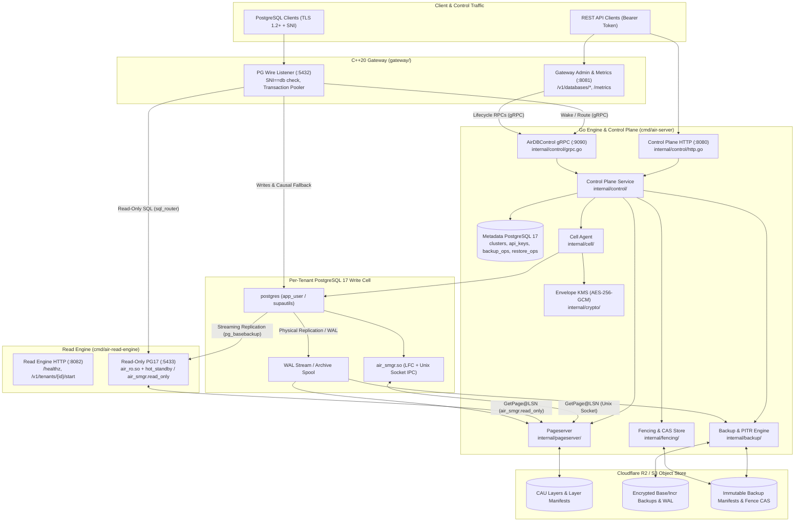

# AIR Architecture Overview

AIR (`v2.0`) is a multi-tenant PostgreSQL 17 database platform engineered for cooperative scale-to-zero, disaggregated page storage, and encrypted Cloudflare R2 backups with Point-in-Time Recovery (PITR).

For a detailed package dependency map and code navigation reference, see [codebase-map.md](file:///workspaces/air/docs/architecture/codebase-map.md).

---

## 1. Architectural Goals

1. **Multi-Tenant Isolation without Container-Per-Tenant Overhead**:
   - Each tenant runs as an isolated PostgreSQL 17 cluster (`PGDATA` under `<data-dir>/pgdata/<tenant_id>`) hardened with `supautils.so`, restricted `app_user` privileges, per-tenant Linux `cgroup v2` resource limits, `flock` single-owner directory locks, and unique per-tenant AES-256-GCM data encryption keys (`EnvelopeKMS`).
2. **Cooperative Scale-to-Zero & Cold Offload**:
   - Idle databases automatically suspend after `--idle-timeout` once active transactions, prepared transactions, `LISTEN/NOTIFY` channels, temporary tables, and session advisory locks drain cleanly.
   - Suspended databases can be offloaded to Cloudflare R2 and evicted from local disk after `--offload-idle-duration`, waking transparently on the next client connection or API call.
3. **Disaggregated Storage (`air_smgr` + `pageserver`)**:
   - PostgreSQL 17's storage manager (`smgr_hook`) intercepts 8 KiB relation block reads (`air_smgr.so`) and fetches missing pages at an explicit LSN (`GetPage@LSN`) from the local Go Pageserver (`internal/pageserver`), which materializes pages from in-memory WAL records, L0 delta layers, L1 compacted layers, and R2 Content-Addressed Upload (CAU) layer objects.
4. **Generation-Fenced Durability**:
   - Every wake or epoch transition increments the tenant's monotonic fencing generation (`Epoch`) via HTTP `If-Match` Compare-And-Swap (CAS) on R2 (`tenants/{tenant_id}/manifest.json`) and a `CLOCK_MONOTONIC` watchdog (`internal/fencing`), preventing split-brain writes or stale background jobs from mutating R2 state.

---

## 2. System Topology

---

## 3. Component Summary

| Component | Package / Directory | Primary Responsibilities |
| :--- | :--- | :--- |
| **Server Entrypoint** | [cmd/air-server](file:///workspaces/air/cmd/air-server/main.go) | Parses flags/env ([internal/config](file:///workspaces/air/internal/config/config.go)), initializes `cell.Agent`, `pageserver.Server`, and `control.Service`, runs startup reconciliation, and serves HTTP (`:8080`) + gRPC (`:9090`). |
| **Read Engine Entrypoint** | [cmd/air-read-engine](file:///workspaces/air/cmd/air-read-engine/main.go) | Supervises standalone read-only PostgreSQL 17 instances (`air_ro.so`, `hot_standby = on`, `pg_basebackup` streaming standby or `air_smgr.read_only`) with HTTP control on `:8082`. |
| **Control Plane** | [internal/control](file:///workspaces/air/internal/control/control.go) | Manages metadata tables (`clusters`, `api_keys`, `backup_ops`, `restore_ops`), tenant state transitions, `singleflight` wake coalescing, idle suspend reaper, cold offload worker, and backup/restore orchestration. |
| **Cell Agent** | [internal/cell](file:///workspaces/air/internal/cell/agent.go) | Manages local PostgreSQL 17 processes, warm `initdb` pool, `flock` lockfiles, `cgroup v2` limits, `supautils` configuration, cooperative drain checks, and local `EnvelopeKMS` access. |
| **Pageserver** | [internal/pageserver](file:///workspaces/air/internal/pageserver/server.go) | Consumes PostgreSQL WAL via replication or local PGDATA segments, maintains per-timeline `InMemoryLayer`, L0/L1/Image disk layers, serves `GetPage@LSN` to `air_smgr.so`, and uploads CAU layers to R2. |
| **Storage Manager Extension** | [extensions/air_smgr](file:///workspaces/air/extensions/air_smgr/air_smgr.c) | Custom PostgreSQL 17 `f_smgr` implementation with a local file cache (LFC), `air_smgr.read_only` mode, and Unix socket client to `pageserver`. |
| **Read-Only Guard Extension** | [extensions/air_ro](file:///workspaces/air/extensions/air_ro/air_ro.c) | Native PG17 C extension (`air_ro.enabled = on`) enforcing read-only execution across `ExecutorStart_hook`, `ProcessUtility_hook`, and `object_access_hook`. |
| **Backup & PITR** | [internal/backup](file:///workspaces/air/internal/backup/pitr_dag.go) | Executes encrypted `pg_basebackup` (FULL and INCR), WAL spooling and archival, immutable `BackupManifest` publication, object/checksum verification, and `StagePITRRestore` recovery. |
| **Fencing & CAS** | [internal/fencing](file:///workspaces/air/internal/fencing/r2_cas.go) | Enforces `CLOCK_MONOTONIC` lease watchdog checks and R2 ETag CAS (`If-Match` / `If-None-Match`) updates on `tenants/{tenant_id}/manifest.json`. |
| **C++20 Gateway** | [gateway/src](file:///workspaces/air/gateway/src/main.cpp) | Accepts client PostgreSQL connections (`:5432`), enforces TLS 1.2+ and `SNI == database`, pools backend connections in transaction mode, routes read-only queries to Read Engine with LSN causal-lag fallback, and triggers tenant wake via gRPC. |

---

## 4. Detailed Architecture Guides

- [Pageserver & `air_smgr` Architecture](file:///workspaces/air/docs/architecture/pageserver.md)
- [Read-Only Engine & Storage Adapter](file:///workspaces/air/docs/architecture/read-engine.md)
- [Object Storage & R2 Key Layout](file:///workspaces/air/docs/architecture/storage.md)
- [Tenant Lifecycle, Generations & Offload](file:///workspaces/air/docs/architecture/tenant-lifecycle.md)
- [WAL Ingestion, Archival & Crash Recovery](file:///workspaces/air/docs/architecture/wal-and-recovery.md)
- [Backup, Manifest Verification & PITR Restore](file:///workspaces/air/docs/architecture/backup-and-restore.md)
- [Codebase Map & Concurrency Invariants](file:///workspaces/air/docs/architecture/codebase-map.md)
