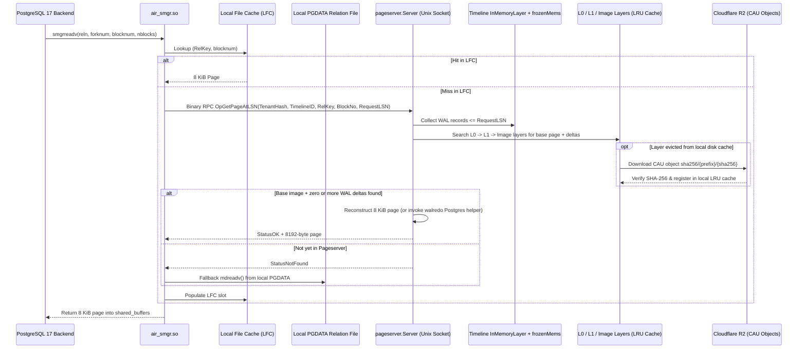

# Pageserver & `air_smgr` Architecture

AIR decouples PostgreSQL 17 relation storage from local disk using two cooperating components:
1. **`air_smgr` ([extensions/air_smgr/air_smgr.c](file:///workspaces/air/extensions/air_smgr/air_smgr.c))**: A C storage manager extension loaded into PostgreSQL 17 via [patches/pg17-smgr-hook.patch](file:///workspaces/air/patches/pg17-smgr-hook.patch).
2. **`internal/pageserver` ([internal/pageserver/server.go](file:///workspaces/air/internal/pageserver/server.go))**: An in-process Go storage engine that ingests WAL, indexes page versions by `(RelKey, BlockNo, LSN)`, compacts immutable layer files, and uploads content-addressed layers to Cloudflare R2.

---

## 1. End-to-End Page Read Path (`GetPage@LSN`)

---

## 2. Binary IPC Protocol (`internal/pageserver/protocol.go`)

Communication between `air_smgr.so` and `pageserver.Server` uses a fixed-size binary framing over a Unix domain socket (`--pageserver-socket`, default `/tmp/air-pageserver.sock`).

### Request Frame (49 bytes, Big-Endian)

| Offset | Size | Field | Description |
| :--- | :--- | :--- | :--- |
| `0` | `1 B` | `Op` | `1 = OpGetPageAtLSN`, `2 = OpNblocks`, `3 = OpPing`, `4 = OpPreloadCheck` |
| `1..8` | `8 B` | `TenantID` | 64-bit FNV-1a hash of the canonical tenant ID string (`HashName(tenantID)`) |
| `9..16` | `8 B` | `TimelineID` | Timeline identifier (default `1`) |
| `17..20` | `4 B` | `SpcNode` | Tablespace OID (e.g., `1663` for `pg_default`, `1664` for `pg_global`) |
| `21..24` | `4 B` | `DbNode` | Database OID (`0` for shared catalog relations like `pg_authid`) |
| `25..28` | `4 B` | `RelNode` | Relation filenode |
| `29` | `1 B` | `ForkNum` | Fork number (`0 = main`, `1 = fsm`, `2 = vm`, `3 = init`) |
| `30..33` | `4 B` | `BlockNo` | 0-indexed 8 KiB block number (`0xFFFFFFFF` for `OpNblocks`) |
| `34..40` | `7 B` | `Reserved` | Zero-padded alignment bytes |
| `41..48` | `8 B` | `RequestLSN` | 64-bit PostgreSQL LSN ceiling for page visibility |

### Response Frame

- **Header (5 bytes)**: `Status` (`1 B`: `0 = StatusOK`, `1 = StatusNotFound`, `2 = StatusError`) + `PayloadLen` (`4 B`, Big-Endian).
- **Payload**:
  - `OpGetPageAtLSN`: `8192` bytes (`PageSize`) when `Status == StatusOK`.
  - `OpNblocks`: `4` bytes (`uint32` block count).
  - `OpPreloadCheck`: `4` bytes (`uint32` count of loaded layers for the timeline).

---

## 3. Layer Hierarchy & Compaction (`internal/pageserver/layer.go`)

Each tenant timeline (`pageserver.Timeline`) manages a hierarchy of immutable disk layers and a mutable in-memory buffer:

1. **`InMemoryLayer` (`mem`) & `frozenMems`**:
   - Incoming WAL records parsed by [walrecord.go](file:///workspaces/air/internal/pageserver/walrecord.go) are appended to the active `InMemoryLayer`.
   - When `mem.Size() >= flushBytes` (default 16 MiB) or `Flush()` is explicitly invoked (e.g., before tenant suspend or offload), `mem` is rotated into `frozenMems` under `Timeline.mu` and written asynchronously to disk without blocking concurrent `GetPageAtLSN` readers.
2. **L0 Delta Layers (`LayerLevelL0`)**:
   - Contain all page versions across all relations for a contiguous LSN window `[StartLSN, EndLSN]`.
3. **L1 Key-Partitioned Delta Layers (`LayerLevelL1`)**:
   - When L0 layer count reaches the compaction threshold (`l0CompactThreshold = 4`), `compactLocked` merges L0 layers and partitions them by key space (`RelKey`, `BlockNo`) into non-overlapping L1 delta layers.
4. **Image Layers (`LayerLevelImage`)**:
   - Materialized full 8 KiB base page images at a specific snapshot LSN, bounding the number of delta layers a `GetPage@LSN` request must traverse.

---

## 4. Content-Addressed Upload (CAU) & Preload (`internal/pageserver/r2_cau.go`)

When a layer file is written to disk and R2 is configured (`R2LayerStore`):
1. **Content Hashing**: The layer file's SHA-256 digest is computed (`<64-hex>`).
2. **Deduplicated Upload**: The layer is uploaded to `tenants/{tenant_id}/layers/sha256/{sha[0:2]}/{sha}` using `If-None-Match: *`. If the object already exists (`412 Precondition Failed`), the upload is skipped as a deduplicated hit (`CAUDedupSkipped`).
3. **CAS Layer Manifest Update**: The timeline's `tenants/{tenant_id}/timeline_{epoch}/layer_manifest.json` is updated using ETag CAS (`If-Match`) with the tenant's active fencing `Epoch`.
4. **Wake & Startup Preload (`EnsureTenantPreloaded`)**:
   - Before starting or adopting a tenant's PostgreSQL 17 process during `WakeTenant` or startup `Reconcile`, the Control Plane calls `PreloadTenantLayers` so catalog relations (`pg_control`, `global/1260` / `pg_authid`, `base/...`) are immediately available to `air_smgr.so`.
