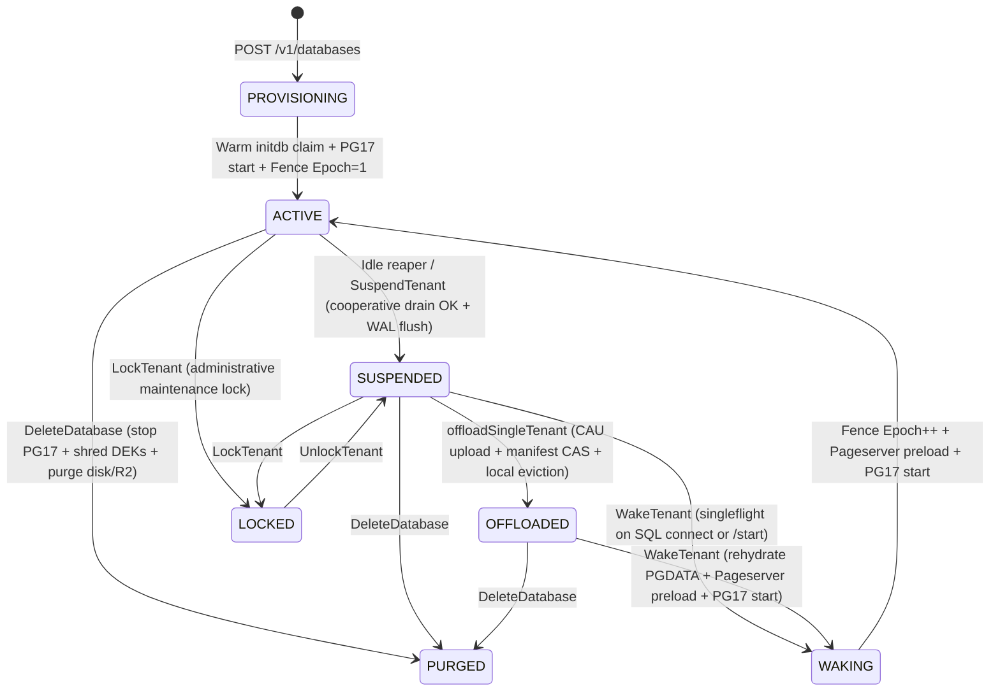

# Tenant Lifecycle, Generations & Cold Offload

AIR manages each tenant database through an explicit state machine persisted in the `clusters` table of the metadata PostgreSQL 17 instance and coordinated in memory by `control.Service` ([internal/control/control.go](file:///workspaces/air/internal/control/control.go)).

---

## 1. Tenant Lifecycle State Machine

### State Definitions

| State | PostgreSQL Process | Local `PGDATA` | R2 Storage | Description |
| :--- | :--- | :--- | :--- | :--- |
| `PROVISIONING` | Starting | Populating from warm pool | Initializing | Transient state during `CreateDatabase`. |
| `ACTIVE` | Running (`postmaster.pid` + `.air.lock`) | Present | Active `Epoch` | Serving SQL traffic and streaming/archiving WAL. |
| `SUSPENDED` | Stopped (`pg_ctl stop -m fast`) | Present | Flushed | Compute scaled to zero; local disk state retained for fast wake. |
| `OFFLOADED` | Stopped | Evicted (`offloaded_at` set) | Authoritative (`layer_manifest.json` + backups) | Compute and local disk scaled to zero; rehydrated from R2 on wake. |
| `WAKING` | Starting | Present / Rehydrating | Incrementing `Epoch` | Coalesced via `singleflight.Group` (`wakeGroup`). |
| `LOCKED` | Stopped | Present | Frozen | Administrative lock rejecting client wakes (`ErrTenantLocked`). |
| `PURGED` | Terminated | Deleted | Tombstoned / DEKs shredded | Terminal state after `DELETE /v1/databases/{id}`. |

---

## 2. Monotonic Generations (`Epoch` & `lifecycleSeq`)

AIR uses two complementary monotonic counters to prevent split-brain execution and stale background operations:

1. **Durable Fencing `Epoch` (`clusters.epoch` & R2 `TenantFenceManifest.Epoch`)**:
   - Incremented on every `WakeTenant` via `fencing.R2CASStore.FenceNewEpoch(ctx, tenantID, nodeID)` using HTTP `If-Match` CAS on `tenants/{tenant_id}/manifest.json`.
   - Every backup artifact, WAL upload, and Pageserver layer manifest update carries the tenant's `Epoch` and validates it against R2 before mutating state.
2. **In-Memory `lifecycleSeq` (`control.Service.lifecycleSeq[tenantID]`)**:
   - Incremented under `s.mu` whenever a tenant transitions between `ACTIVE`, `SUSPENDED`, `OFFLOADED`, `LOCKED`, or `PURGED`.
   - Long-running background tasks (`offloadSingleTenant`, `backupTenantToR2`) snapshot `(epoch, startSeq)` in Phase 1 before releasing `s.mu` for network I/O, and re-verify `s.lifecycleSeq[tenantID] == startSeq` in Phase 3 before committing metadata updates or evicting local files.

---

## 3. Cooperative Scale-to-Zero (`SuspendTenant`)

Before suspending an `ACTIVE` tenant, `cell.Agent.CheckCooperativeDrain` queries `pg_stat_activity`, `pg_prepared_xacts`, `pg_listening_channels()`, `pg_locks`, and temporary namespaces:
- Suspension is vetoed (`cell.ErrDrainVetoed`) if any of the following exist:
  - Active client transactions (`state IN ('active', 'idle in transaction', 'idle in transaction (aborted)')`)
  - Prepared two-phase commit transactions (`pg_prepared_xacts`)
  - Active `LISTEN` registrations
  - Session-level advisory locks
  - Temporary tables in `pg_temp_*`
- Once drain checks pass, `SuspendTenant`:
  1. Flushes and stops the Pageserver WAL receiver for the tenant.
  2. Stops PostgreSQL 17 cleanly (`pg_ctl stop -m fast`), writing a shutdown checkpoint.
  3. Releases the `.air.lock` flock and marks `state = 'SUSPENDED'` in metadata PG.

---

## 4. Three-Phase Lock-Free Cold Offload ([internal/control/offload.go](file:///workspaces/air/internal/control/offload.go))

To ensure R2 uploads never block concurrent API calls or tenant wakes, `offloadSingleTenant` executes in three distinct phases:

1. **Phase 1 (Under `s.mu`)**:
   - Verify the tenant is `SUSPENDED` and has been idle longer than `--offload-idle-duration`.
   - Snapshot `epoch` and `startSeq = s.lifecycleSeq[tenantID]`.
   - Release `s.mu`.
2. **Phase 2 (Unlocked Network & Disk I/O)**:
   - Flush all in-memory Pageserver layers to disk (`psServer.FlushTenant`).
   - Upload all local `.layer` files to R2 via Content-Addressed Upload (`r2Store.UploadLayerCAU`) and publish `layer_manifest.json` via ETag CAS.
   - Verify every referenced layer exists in R2 (`VerifyManifestLayersInR2`).
3. **Phase 3 (Re-acquire `s.mu`)**:
   - Check `s.lifecycleSeq[tenantID] == startSeq` and `rec.State == StateSuspended`.
   - If a concurrent `WakeTenant` or `DeleteDatabase` occurred during Phase 2, abort local eviction cleanly (`ErrOffloadAbortedWake`).
   - Otherwise, evict local `PGDATA`, `lfc/<tenant_id>` (64 MB hot cache), WAL spool, backup staging, and Pageserver `DiskCache`/local layer files (via `EvictTenantLocalData` and `EvictTenantCache`), leaving suspended tenants at zero local cache usage. On wake, only the metadata skeleton and layer manifest are restored—actual relation pages are fetched on demand as queries run.
