# WAL Ingestion, Archival & Crash Recovery

AIR processes PostgreSQL 17 Write-Ahead Log (WAL) through two complementary pipelines:
1. **Pageserver WAL Ingestion (`internal/pageserver`)**: Parses WAL records in real time to materialize 8 KiB relation pages at any LSN (`GetPage@LSN`).
2. **Encrypted R2 WAL Archival (`internal/backup`)**: Archives 16 MiB WAL segment files (`.air_wal_spool`) compressed with Zstandard and encrypted with AES-256-GCM to Cloudflare R2 for Point-in-Time Recovery (PITR).

---

## 1. Pageserver Real-Time WAL Ingestion

```mermaid
flowchart LR
    PG["Tenant PostgreSQL 17"] -->|"walsender / pg_wal segments"| WR["WALReceiver<br/>internal/pageserver/walreceiver.go"]
    WR --> Dec["PG17 WAL Decoder<br/>internal/pageserver/walrecord.go"]
    Dec --> Mem["InMemoryLayer (mem)<br/>internal/pageserver/layer.go"]
    Mem -->|"Rotate at flushBytes"| Frozen["frozenMems"]
    Frozen -->|"Flush to Disk"| L0["L0 Delta Layer (.layer)"]
    L0 -->|"CAU Upload + CAS"| R2[("Cloudflare R2")]
```

- **Replication & Local Segment Fallback**: `WALReceiver` connects to the tenant PostgreSQL 17 instance using the physical replication protocol (`START_REPLICATION`) and falls back to scanning closed segment files in `pg_wal/` if replication is interrupted.
- **Record Decoding**: [walrecord.go](file:///workspaces/air/internal/pageserver/walrecord.go) decodes PostgreSQL 17 `XLogRecord` headers (`xl_tot_len`, `xl_xid`, `xl_prev`, `xl_info`, `xl_rmid`), extracts block references (`BKPBLOCK_*`), full-page writes (`BKPIMAGE_*`), and WAL payload fragments, and indexes them by `(RelKey, BlockNo, LSN)`.
- **WAL Redo (`internal/pageserver/walredo.go`)**: When a delta record requires PostgreSQL-native redo application rather than a full-page image replacement, `PostgresRedoApplier` applies the WAL record sequence onto the base 8 KiB page image.

---

## 2. Encrypted R2 WAL Archival Pipeline

1. **PostgreSQL `archive_command` Spooling**:
   - `cell.Agent.ConfigureWALSpooling(tenantID)` configures the tenant's `postgresql.conf` with:
     - `wal_level = replica`
     - `archive_mode = on`
     - `archive_command = 'cp %p <pgdata>/.air_wal_spool/%f'`
2. **Spool Drain (`backup.DrainAndUploadWALSpool`)**:
   - Triggered automatically after every FULL/INCR backup (`TriggerBackup("FULL"|"INCR")`) or explicitly via `POST /v1/databases/{id}/backups` with `{"type": "WAL"}`.
   - When `forceSwitch == true`, executes `SELECT pg_switch_wal()` (and retries until the switched segment appears in `.air_wal_spool/`) so all committed transactions up to the current LSN are archived.
   - For each spooled segment:
     1. Validates the filename via `isValidWALFilename` (rejects traversal or non-hex names).
     2. Checks the fencing watchdog (`watchdog.CheckLease()`) and verifies `Epoch` against R2.
     3. Computes `PlainSHA256` over the raw 16 MiB WAL segment.
     4. Compresses the segment with Zstandard (`CompressBytesZstd`) and encrypts it with `EnvelopeKMS.EncryptObject` (`AES-256-GCM`), computing `CipherSHA256` over the encrypted payload.
     5. Uploads to `tenants/{tenant_id}/timeline_{epoch}/wal/{segment_name}.wal.zst.enc` with custom metadata headers (`x-amz-meta-air-plain-sha256`, `x-amz-meta-air-cipher-sha256`, `x-amz-meta-air-sha256`).
     6. Appends the `WALSegmentArtifact` to the local `wal_upload_manifest.json` and updates the R2 `TenantFenceManifest.WALSegments` via ETag CAS, then unlinks the local spool file.

---

## 3. WAL LSN Math & Continuity Validation (`internal/backup/lsn.go`)

PostgreSQL 17 standard WAL segments are 16 MiB (`0x1000000` bytes) named with 24 uppercase hexadecimal characters:
$$\text{SegmentName} = \underbrace{\text{TimelineID}}_{8\text{ hex}} \parallel \underbrace{\text{LogSegHi}}_{8\text{ hex}} \parallel \underbrace{\text{LogSegLo}}_{8\text{ hex}}$$

- **Start LSN**: $\text{StartLSN} = (\text{LogSegHi} \ll 32) + (\text{LogSegLo} \times \text{0x1000000})$.
- **End LSN**: $\text{EndLSN} = \text{StartLSN} + \text{0x1000000}$.
- **Continuity Invariant (`ValidateWALContinuity(segments, startLSN, endLSN)`)**:
  1. Auxiliary timeline history/backup files (`.history`, `.backup`) are filtered via `IsWALSegmentName` (24-hex check) so they can be staged for PostgreSQL recovery without breaking 16 MiB segment arithmetic.
  2. The sorted 24-hex segments must share a consistent `TimelineID`.
  3. The first segment covering `startLSN` (`firstSegment = (startLSN / 16 MiB) * 16 MiB`) must be present (`segs[0].start <= firstSegment`, allowing earlier retained segments).
  4. Every subsequent segment beyond `firstSegment` must be strictly contiguous (`segs[i].start == segs[i-1].start + 16 MiB`) with no duplicates or gaps.
  5. The final segment's coverage window (`segs[last].start + 16 MiB`) must cover `endLSN`.

---

## 4. Startup Crash Reconciliation (`internal/control/migrations.go`)

When `air-server` restarts after an unclean crash:
1. **`reconcileInterruptedBackupAndRestoreOps` ([migrations.go](file:///workspaces/air/internal/control/migrations.go))**:
   - Scans `backup_ops` and `restore_ops` for any rows left in `RUNNING` state from a prior process incarnation and transitions them to `FAILED` (`interrupted by control plane restart`) so operators and clients never observe stuck in-progress operations.
2. **`Service.Reconcile` ([control.go](file:///workspaces/air/internal/control/control.go))**:
   - Queries `clusters` for all known tenants.
   - For tenants marked `ACTIVE` in metadata DB, probes whether the local PostgreSQL 17 process is alive and responsive; if alive, re-adopts the process (`AdoptRunningTenant`) and preloads Pageserver layers (`EnsureTenantPreloaded`); if dead, marks the tenant `SUSPENDED` so the next request cleanly wakes it under a new fencing `Epoch`.
