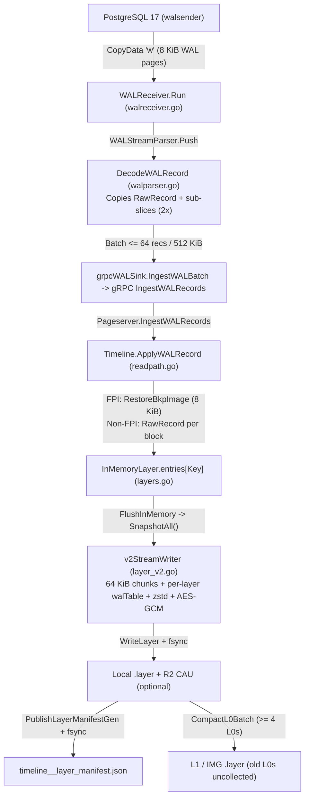

# AIR Content-Addressed WAL (CA-WAL) — Phase 1 Forensics Report

**Date:** 2026-11-24  
**Repository:** `github.com/Mahadi-rsio/air`  
**Base Commit:** `518a0c5b` (`phase22: publish Phase 4 benchmark matrix and 30-minute soak report`)  
**Objective:** Trace the complete PostgreSQL 17 WAL lifecycle across AIR, identify physical memory copies, physical storage duplication, and logical WAL record duplication, and evaluate where a Content-Addressed WAL (CA-WAL) architecture and targeted memory optimizations can safely reduce memory retention, GC pressure, and storage overhead on 256 MB and 512 MB Fly.io machines.

---

## 1. Executive Summary

AIR processes PostgreSQL 17 WAL through **two distinct pipelines**:
1. **Real-Time Pageserver WAL Pipeline (`internal/pageserver`, `internal/control`)**: Physical replication (`START_REPLICATION`) streams WAL pages from PostgreSQL 17 to `WALReceiver`, which decodes `XLogRecord`s and forwards them (via gRPC `IngestWALRecords` in distributed mode or directly in-process) into `Timeline.InMemoryLayer`, which flushes to V2 `.layer` files (`LayerStore`) and compacts `L0 -> L1/IMG`.
2. **PITR WAL Archival Pipeline (`internal/backup`)**: PostgreSQL `archive_command` spools 16 MiB WAL segments to `.air_wal_spool/`, where `drainWALSpoolDirWithFaultGen` compresses (zstd), encrypts (AES-256-GCM), and uploads them to R2 for Point-in-Time Recovery (`CombineAndReplayPITR`).

Our forensics inspection (building on Phase 22's `GOMEMLIMIT` and `MemoryBudget` foundation) identified **concrete duplication and allocation hotspots** in both pipelines, while also distinguishing **three separate phenomena** that must not be conflated:
- **Duplicate physical memory copies**: `DecodeWALRecord` copies every WAL record twice (`RawRecord` + individual `ImagePayload`/`BlockData`/`MainData` slices); `decodeV2WALTable` instantiates a fresh `zstd.NewReader` per call; `lookupKeysInLayerV2` clones immutable `walTable` slices on every read; `drainWALSpoolDirWithFaultGen` buffers 16 MiB raw + compressed + encrypted segments simultaneously (~32–48 MiB peak).
- **Duplicate physical storage blobs**: V2 `.layer` files already deduplicate identical `WALRecord` bytes *within* a single layer via `v2StreamWriter.internWAL` (`walTable`), **but** do not share WAL blobs across L0 layers, compacted L1 layers, or tenants, and compacted L0 files are never garbage-collected from local disk/R2.
- **Duplicate logical WAL records**: `WALReceiver.Run` aligns `START_REPLICATION` to an 8 KiB WAL page boundary (`startLSN & ^uint64(8191)`), causing already-ingested WAL records on the boundary page to be re-parsed and re-applied on reconnect; multi-block non-FPI WAL records attach `rec.RawRecord` to every referenced block key in `InMemoryLayer` and overcount `ApproxBytes`.

---

## 2. Complete WAL Lifecycle & Source Map

### 2.1 Relevant Source Files and Functions

| Stage | File | Key Functions / Types |
|---|---|---|
| **1. WAL Generation & Replication** | [`internal/pageserver/walreceiver.go`](file:///workspaces/air/internal/pageserver/walreceiver.go) | `WALReceiver.Run` (L62–193), `WALReceiver.IngestWALPages` (L45–59), `WALBatchSink` (L14–16) |
| **2. WAL Stream Parsing & Decoding** | [`internal/pageserver/walparser.go`](file:///workspaces/air/internal/pageserver/walparser.go) | `WALStreamParser.Push` (L415–537), `WALStreamParser.consumePage` (L397–412), `DecodeWALRecord` (L95–263), `RestoreBkpImage` (L266–300), `ParseWALPages` (L303–379) |
| **3. FPI Decompression** | [`internal/pageserver/fpi_decompress.go`](file:///workspaces/air/internal/pageserver/fpi_decompress.go) | `decompressFPIPayload` (L10–35), `pglzDecompressFPI` (L38–77), `lz4BlockDecompressFPI` (L80–141) |
| **4. Server-to-Pageserver Transport** | [`internal/control/pageserver_client.go`](file:///workspaces/air/internal/control/pageserver_client.go) | `grpcWALSink.IngestWALBatch` (L617–705), `GRPCPageserverClient.NewWALReceiver` (L707–714) |
| **5. Pageserver gRPC Ingestion** | [`internal/pageserver/grpc.go`](file:///workspaces/air/internal/pageserver/grpc.go) | `grpcServer.IngestWALRecords` (L539–593), `Pageserver.IngestWALRecords` (L112–173) |
| **6. Buffering & Page State** | [`internal/pageserver/readpath.go`](file:///workspaces/air/internal/pageserver/readpath.go) | `Timeline.ApplyWALRecord` (L418–641), `Timeline.FlushInMemory` (L677–793), `Timeline.GetPageAtLSN` (L796–866), `Timeline.GetPageBatch` (L901–1048) |
| **7. InMemoryLayer & LayerStore** | [`internal/pageserver/layers.go`](file:///workspaces/air/internal/pageserver/layers.go) | `InMemoryLayer.Put` (L105–148), `InMemoryLayer.SnapshotAll` (L175–198), `LayerStore.WriteLayer` (L635–802), `LayerStore.PublishLayerManifestGen` (L1838–1924) |
| **8. V2 Chunking, Compression & WAL Table** | [`internal/pageserver/layer_v2.go`](file:///workspaces/air/internal/pageserver/layer_v2.go) | `v2StreamWriter.internWAL` (L229–243), `v2StreamWriter.flushChunk` (L245–322), `v2StreamWriter.Finish` (L341–462), `decodeV2WALTable` (L569–653), `lookupKeysInLayerV2` (L753–934) |
| **9. Content-Addressed Upload (CAU)** | [`internal/pageserver/cau.go`](file:///workspaces/air/internal/pageserver/cau.go) | `ContentAddressedLayerKeyGen` (L101–115), `StreamSHA256` (L163–171) |
| **10. Compaction & Merging** | [`internal/pageserver/compactor.go`](file:///workspaces/air/internal/pageserver/compactor.go) | `Timeline.compactL0s` (L30–218), `LayerStore.writeLayerFromStream` (L222–350) |
| **11. WAL Replay (Redo)** | [`internal/pageserver/walredo.go`](file:///workspaces/air/internal/pageserver/walredo.go) | `prepareRedo` (L139–166), `DefaultWALRedoer.Redo` (L169–194), `DefaultWALRedoer.RedoBatch` (L197–260) |
| **12. Memory Budget & Eviction** | [`internal/pageserver/memory_budget.go`](file:///workspaces/air/internal/pageserver/memory_budget.go) | `MemoryBudget.monitorLoop`, `ResolveMemoryBudgetConfig` (L121–181) |
| **13. PITR WAL Spool & Recovery** | [`internal/backup/pitr_dag.go`](file:///workspaces/air/internal/backup/pitr_dag.go) | `drainWALSpoolDirWithFaultGen` (L562–717), `CombineAndReplayPITR` (L723–734) |
| **14. Recovery & Tenant Purge** | [`internal/pageserver/server.go`](file:///workspaces/air/internal/pageserver/server.go) | `Pageserver.recoverLocalTenants` (L110–219), `Pageserver.PurgeTenant` (L348–430) |

> **Note on `air-gateway`:** `internal/gateway/` does **not** transport or buffer WAL. Gateway proxies client SQL/wire connections; WAL transport occurs between `air-server` (`WALReceiver` + `grpcWALSink`) and `air-pageserver` (`grpcServer.IngestWALRecords`).

### 2.2 Actual Data Flow

---

## 3. Duplication & Memory Allocation Hotspots

### 3.1 Duplicate Physical Memory Copies (RAM & GC Pressure)

1. **`DecodeWALRecord` double-copy (`internal/pageserver/walparser.go:113, 241, 251, 260`):**
   - `RawRecord` allocates and copies `totLen` bytes (`append([]byte(nil), recBuf...)`).
   - Then `ImagePayload` (L241), `BlockData` (L251), and `MainData` (L260) each allocate and copy slices *from the exact same `recBuf`*!
   - **Impact:** 2x heap allocation and `memmove` for every single WAL record parsed on `air-server` (or in-process `Pageserver`).

2. **`decodeV2WALTable` per-call `zstd.NewReader` (`internal/pageserver/layer_v2.go:597`):**
   - `decodeV2WALTable` calls `zstd.NewReader(bytes.NewReader(payload))` on every V2 WAL table load instead of using the singleton `v2ZstdDec` from `getV2Zstd()`.
   - **Impact:** Allocates a multi-megabyte zstd decoder state and spawns background goroutines per call under read-heavy non-FPI workloads, directly threatening 256 MB containers.

3. **`lookupKeysInLayerV2` clones immutable `walTable` entries (`internal/pageserver/layer_v2.go:929`):**
   - `rm.delta.WALRecord = append([]byte(nil), walTable[idx]...)` copies every referenced WAL record on every layer lookup, even though `walTable[idx]` is immutable once decoded.

4. **`Timeline.ApplyWALRecord` multi-block `WALRecord` reference & `ApproxBytes` inflation (`internal/pageserver/readpath.go:428-469`, `layers.go:95-101`):**
   - When a non-FPI WAL record touches $k$ blocks (e.g., B-tree page split, heap multi-insert), `delta.WALRecord = rec.RawRecord` is appended to `m.entries[blk_i]` for all $k$ blocks.
   - `deltaApproxBytes` counts `len(delta.WALRecord)` $k$ times, inflating `InMemoryLayer.ApproxBytes` and triggering premature L0 flushes (creating more small L0 files).

5. **`drainWALSpoolDirWithFaultGen` full-segment buffering (`internal/backup/pitr_dag.go:624-642`):**
   - `os.ReadFile(segPath)` loads the entire 16 MiB WAL segment into RAM, then `CompressBytesZstd` allocates a compressed buffer, then `kms.EncryptObject` allocates an encrypted buffer (~32–48 MiB live heap per concurrent archival).

6. **`SnapshotAll()` flat slice allocation (`internal/pageserver/layers.go:175-198`):**
   - Allocates `[]LayerRecord` for all entries in `inMem` while `oldMem` remains in `frozenMems` until `WriteLayer` + `PublishLayerManifestGen` finish. (Bounded by `PerTenantSoftInMemBytes` = 2 MiB on 256 MB, so ~100–300 KiB per flush, well-controlled after Phase 22.)

### 3.2 Duplicate Physical Storage Blobs

1. **Per-layer `walTable` vs. Cross-Layer / Cross-Tenant WAL Blobs (`internal/pageserver/layer_v2.go:229-243`):**
   - `v2StreamWriter.internWAL` deduplicates identical `WALRecord` byte slices *within a single `.layer` file* using `sha256.Sum256(wal)`.
   - However, **across L0 layers, L1 compacted layers, and across tenants**, non-FPI WAL records and repeated WAL payloads are stored independently in each `.layer` file's `walTable`.
   - Furthermore, `compactor.go` compacts L0s into L1 (copying/re-encoding `walTable` entries into the new L1), **and never deletes the superseded L0 files** from local disk or R2.

2. **PITR WAL Segment Archival (`internal/backup/pitr_dag.go:636`):**
   - Segments are uploaded to `tenants/{tenantID}/{gen}/epoch_{epoch:06d}/wal/{segName}.zst.enc` (epoch-scoped rather than content-addressed), so re-archived or identical segments across epochs are stored multiple times.

### 3.3 Duplicate Logical WAL Records

1. **Page-aligned `START_REPLICATION` replay (`internal/pageserver/walreceiver.go:94`):**
   - `alignedStart := startLSN & ^uint64(XLogPageSize-1)` aligns replication start to the 8 KiB WAL page boundary.
   - On every `WALReceiver` reconnect (e.g., tenant wake, network blip), PostgreSQL re-streams all records on that 8 KiB page prior to `startLSN`.
   - `IngestWALRecords` (`internal/pageserver/grpc.go:112`) has **no LSN high-water-mark check** (`rec.EndLSN <= tl.walLastLSN`), so it re-applies already-committed WAL records into `InMemoryLayer`.

---

## 4. Estimated Duplicate Memory & Storage Overhead

| Source | Category | Estimated Overhead (256 MB / 10-Tenant Profile) |
|---|---|---|
| `DecodeWALRecord` double-copy (`RawRecord` + sub-slices) | Memory (alloc rate / GC) | **~2x** WAL stream allocation rate (e.g., +10–30 MB/min under write load) |
| `decodeV2WALTable` `zstd.NewReader` per call | Memory (spike + goroutines) | **~4–16 MiB** transient spike per V2 WAL table read |
| `lookupKeysInLayerV2` `walTable[idx]` clone | Memory (alloc rate) | **1x** extra copy per non-FPI delta read |
| `WALReceiver` reconnect page-boundary re-ingestion | Logical / Memory / Storage | Up to **8 KiB** of duplicate deltas per reconnect per tenant |
| Uncollected compacted L0 files (`compactor.go`) | Physical Storage | **100%** of pre-compaction L0 bytes retained on disk indefinitely |
| Cross-layer / cross-tenant non-FPI WAL payloads | Physical Storage | **10–35%** of non-FPI WAL table bytes when workloads emit repeated WAL patterns or compact L0->L1 |

---

## 5. Current WAL Ownership & Lifecycle

1. **`WALReceiver` (`air-server`)**: Owns `WALStreamParser.buf` (reused in-place via `consumePage`). Each `DecodedWALRecord` is heap-allocated per record and passed to `WALBatchSink.IngestWALBatch`, then becomes garbage.
2. **`InMemoryLayer` (`air-pageserver`)**: Owns `entries map[Key][]WALDelta`. Slices (`PageImage`, `WALRecord`) are owned by `InMemoryLayer` until `FlushInMemory` freezes `oldMem` into `frozenMems`. After `WriteLayer` + `PublishLayerManifestGen` succeed, `oldMem` is removed from `frozenMems` and becomes eligible for GC.
3. **`LayerStore` & Caches (`air-pageserver`)**: `DecodedChunkCache` (8–16 MiB LRU) owns decoded 64 KiB V2 chunks; `boundedIndexCache` (8–16 MiB LRU) owns `layerIndexData` including `walTable [][]byte`. Callers of `DecodedChunkCache` and `walTable` must treat returned slices as immutable.

---

## 6. Optimization Opportunities & Risks to Recovery/Durability

### Opportunities
1. **Content-Addressed WAL Blob Store (CA-WAL)** for immutable WAL chunks/payloads using `SHA256(wal_chunk_bytes)` with atomic create-if-absent, reference tracking, and crash-safe GC.
2. **Eliminate `DecodeWALRecord` double-copy**: Share `rec.RawRecord` backing array with `BlockData`, `MainData`, and `ImagePayload` (zero-copy sub-slices).
3. **Fix `decodeV2WALTable` zstd decoder leak**: Reuse `getV2Zstd()` (`v2ZstdDec.DecodeAll`) instead of `zstd.NewReader` per call.
4. **Eliminate `lookupKeysInLayerV2` `walTable` clone**: Treat `walTable[idx]` as immutable (matching `DecodedChunkCache` semantics) and only copy if mutated.
5. **Idempotent LSN filtering on `WALReceiver` / `IngestWALRecords`**: Skip records with `rec.EndLSN <= tl.walLastLSN` (when `walLastLSN > 0`) so page-aligned `START_REPLICATION` reconnects never duplicate already-ingested records.
6. **Safe compacted L0 cleanup**: Once `L1` is durable and manifest is `fsync`ed, mark/GC unreferenced L0 layer files and CA-WAL blobs safely.

### Risks to Recovery and Durability
1. **Never conflate content identity with LSN/Timeline identity**: Two identical WAL payloads at different LSNs or different timelines/tenants MUST retain independent `(TimelineID, StartLSN, EndLSN)` metadata.
2. **Manifest-before-blob ordering hazard**: A manifest or layer index MUST NEVER reference a content-addressed blob until the blob is durably `fsync`ed on disk (and/or verified in R2).
3. **Concurrent write / partial write hazard**: Concurrent writes of the same `SHA256` must use atomic write-temp + `fsync` + `link`/`rename` (create-if-absent) so a reader never observes a truncated blob.
4. **Premature GC hazard**: A blob referenced by multiple layers, manifests, or tenants must never be deleted while any valid reference exists, including during concurrent flush/compaction or crash recovery.
5. **Backward compatibility**: Existing V1 and V2 `.layer` files and `timeline_<epoch>_layer_manifest.json` must remain 100% readable without migration downtime.
