# AIR Platform — Phased Engineering Roadmap (`phase.md`)

> **Companion Tracker:** [todo.md](file:///workspaces/air/todo.md) · **Audit Verdict:** [16-updated-production-verdict.md](file:///workspaces/air/audit/16-updated-production-verdict.md) · **Test Results:** [15-fault-injection-results.md](file:///workspaces/air/audit/15-fault-injection-results.md)

---

## 1. Roadmap Overview

```mermaid
flowchart LR
    subgraph Completed["Completed: AIR v1.0 Single-Cell Foundation"]
        PA["Phase A: PG17 Remediation & Stage Archival"] --> PB["Phase B: Root Architecture & Schema v1"]
        PB --> PC["Phase C: Single-Cell Control + Cell + Gateway"]
        PC --> PD["Phase D: Live PG17 E2E Verification (9/9 Pass)"]
    end

    subgraph Next["Upcoming: AIR v1.1–1.3 Hardening & AIR v2.0 Pooler"]
        PE["Phase E: Bearer API Auth & Mandatory Gateway TLS"]
        PF["Phase F: CAS-Fenced R2 Backups, WAL Spool & Safe PITR"]
        PG["Phase G: Per-Tenant cgroup v2 & External HA Meta DSN"]
        PH["Phase H: Transaction Pooler & Cooperative Scale-to-Zero"]
    end

    PD --> PE --> PF --> PG --> PH
```

| Phase | Milestone | Status | Primary Packages / Files |
| :--- | :--- | :--- | :--- |
| **Phase A** | Live PG17 Remediation Closure & Stage 0–4 Archival | **COMPLETED** (`2bb5c48`) | [stage_test/stage1](file:///workspaces/air/stage_test/stage1), [stage_test/stage4](file:///workspaces/air/stage_test/stage4), [15-fault-injection-results.md](file:///workspaces/air/audit/15-fault-injection-results.md) |
| **Phase B** | Root Go Module & Single-Cell Architecture Design | **COMPLETED** (`b0f9885`) | [go.mod](file:///workspaces/air/go.mod), [001_initial_schema.sql](file:///workspaces/air/migrations/001_initial_schema.sql), [internal/config](file:///workspaces/air/internal/config/config.go), [internal/tenant](file:///workspaces/air/internal/tenant/tenant.go) |
| **Phase C** | Single-Cell Control Plane, Cell Agent & Wire Gateway | **COMPLETED** (`b0f9885`) | [internal/crypto](file:///workspaces/air/internal/crypto/envelope.go), [internal/cell](file:///workspaces/air/internal/cell/agent.go), [internal/control](file:///workspaces/air/internal/control/control.go), [internal/gateway](file:///workspaces/air/internal/gateway/gateway.go), [cmd/air-server](file:///workspaces/air/cmd/air-server/main.go) |
| **Phase D** | Live PostgreSQL 17 End-to-End Milestone Verification | **COMPLETED** (`b0f9885`, `418e49c`) | [tests/e2e/e2e_test.go](file:///workspaces/air/tests/e2e/e2e_test.go) (`TestAIRv1_SingleCellEndToEndMilestones`) |
| **Phase E** | Control Plane Bearer Auth & Mandatory Gateway TLS (`AIR v1.1`) | **NEXT (`PENDING`)** | `migrations/002_api_keys.sql`, [internal/control/http.go](file:///workspaces/air/internal/control/http.go), [internal/gateway/gateway.go](file:///workspaces/air/internal/gateway/gateway.go), [internal/config/config.go](file:///workspaces/air/internal/config/config.go) |
| **Phase F** | Encrypted WAL Durability, CAS Backups & Safe PITR (`AIR v1.2`) | **PLANNED (`PENDING`)** | `internal/fencing`, `internal/backup`, [internal/control/http.go](file:///workspaces/air/internal/control/http.go), [tests/e2e/e2e_test.go](file:///workspaces/air/tests/e2e/e2e_test.go) |
| **Phase G** | Per-Tenant `cgroup v2` Isolation & External HA Meta DB (`AIR v1.3`) | **PLANNED (`PENDING`)** | [internal/cell/agent.go](file:///workspaces/air/internal/cell/agent.go), [internal/control/control.go](file:///workspaces/air/internal/control/control.go), [internal/config/config.go](file:///workspaces/air/internal/config/config.go) |
| **Phase H** | Transaction-Mode Wire Pooler & Cooperative Scale-to-Zero (`AIR v2.0`) | **PLANNED (`PENDING`)** | [internal/gateway](file:///workspaces/air/internal/gateway/gateway.go), [internal/cell/agent.go](file:///workspaces/air/internal/cell/agent.go), [internal/control/control.go](file:///workspaces/air/internal/control/control.go) |

---

## 2. Completed Phases (Phases A–D — `AIR v1.0`)

### Phase A — Remediation Closure & Stage Archival (`COMPLETED`)
- Installed PostgreSQL 17.12 (`postgresql-17`, `postgresql-server-dev-17`) and compiled/installed `/usr/lib/postgresql/17/lib/supautils.so`.
- Executed all 18 unit, fault-injection, and live-PG17 remediation tests across `stage1` (9 PASS, 0 FAIL, 0 SKIP) and `stage4` (9 PASS, 0 FAIL, 0 SKIP) with `go test -v -race -count=1 ./...`.
- Archived `stage0`, `stage1`, `stage2`, `stage3`, and `stage4` into [stage_test/](file:///workspaces/air/stage_test).

### Phase B — Root Architecture & Metadata Schema v1 (`COMPLETED`)
- Initialized root Go module (`github.com/Mahadi-rsio/air`) in [go.mod](file:///workspaces/air/go.mod).
- Codified Control Plane schema v1 in [001_initial_schema.sql](file:///workspaces/air/migrations/001_initial_schema.sql) (`schema_migrations`, `clusters`, `idempotency_records`, `provisioning_ops`).
- Implemented strict tenant/account identifier validation and symlink-safe path containment (`ValidateID`, `SafeSubpath`) in [tenant.go](file:///workspaces/air/internal/tenant/tenant.go).

### Phase C — Single-Cell Runtime Implementation (`COMPLETED`)
- **EnvelopeKMS ([envelope.go](file:///workspaces/air/internal/crypto/envelope.go))**: Persistent `0600` 32-byte master KEK, per-tenant wrapped 256-bit DEKs, `AES-256-GCM` with AAD binding, and `ShredDEK` crypto-shredding.
- **Cell Agent ([agent.go](file:///workspaces/air/internal/cell/agent.go))**: Authentic `initdb --data-checksums` per tenant, `supautils` preload, least-privilege `app_user` (`NOSUPERUSER NOCREATEDB NOCREATEROLE`), `scram-sha-256` auth, exclusive `flock` (`agent.lock`), and `/proc/<pid>/stat` + `system_identifier` + `fencing_epoch` verified re-adoption (`ReadoptRunningTenants`).
- **Control Plane ([control.go](file:///workspaces/air/internal/control/control.go), [http.go](file:///workspaces/air/internal/control/http.go))**: Durable PostgreSQL 17 metadata store (never deletes `MetaDir` on startup; fails closed with `ErrMetadataCorrupted`), transactional migrations, durable `provisioning_ops` state machine (`REQUESTED -> CLAIMED -> ACTIVATING -> ACTIVE / ROLLED_BACK`), startup `RecoverProvisioningOperations`, account-scoped idempotency (`ErrIdempotencyConflict`), and REST endpoints (`GET /healthz`, `POST /v1/databases`, `GET /v1/databases/{id}`, `DELETE /v1/databases/{id}`).
- **PostgreSQL Wire Gateway ([gateway.go](file:///workspaces/air/internal/gateway/gateway.go))**: 1:1 TCP/TLS PostgreSQL wire-protocol proxy with 8 KB `StartupMessage` cap, `SSLRequest` (`80877103`) negotiation, SNI == startup database binding, role enforcement (blocks `postgres` superuser), and active tenant routing.

### Phase D — End-to-End Verification Against Real PostgreSQL 17 (`COMPLETED`)
- Implemented and executed [e2e_test.go](file:///workspaces/air/tests/e2e/e2e_test.go) (`TestAIRv1_SingleCellEndToEndMilestones`) covering all 9 single-cell milestones against real PostgreSQL 17.12 (`pgx` + `psql`):
  1. Service startup & `/healthz`
  2. Tenant provisioning & idempotent replay (with plaintext password scrubbed from `idempotency_records`)
  3. Cross-tenant idempotency conflict (`409`) & cross-account access isolation (`403`)
  4. Real SQL DDL/DML through the Gateway via both `pgx` (TLS) and `psql` CLI
  5. Gateway security rejection of `postgres` superuser login (`28000`) & `supautils` privilege escalation blocking (`42501`)
  6. Data & metadata persistence across `ControlPlane` + `CellAgent` restart (`ReadoptRunningTenants`)
  7. Crash recovery of interrupted mid-flight provisioning (`RecoverProvisioningOperations` -> `ROLLED_BACK`)
  8. Tenant stop, storage purge, DEK shredding, and Gateway routing revocation (`DELETE /v1/databases/{id}`)
  9. Fail-closed metadata corruption guard (`ErrMetadataCorrupted`)

---

## 3. Upcoming Phases (Phases E–H)

### Phase E — Control Plane Bearer Authentication & Mandatory Gateway TLS (`AIR v1.1`)

#### Objective
Close the authentication and transport security prerequisites from [16-updated-production-verdict.md](file:///workspaces/air/audit/16-updated-production-verdict.md#L28):
- Replace unauthenticated trust of the `X-Account-ID` HTTP header with verified Bearer API keys stored in the Control Plane metadata DB.
- Add configurable mandatory TLS enforcement (`--require-tls`) and custom TLS certificate/key loading (`--tls-cert`, `--tls-key`) in the PostgreSQL Wire Gateway.

#### Scope & Deliverables
1. **Schema Migration (`migrations/002_api_keys.sql` & [control.go](file:///workspaces/air/internal/control/control.go))**:
   - Create `api_keys` table (`key_id TEXT PRIMARY KEY`, `key_sha256 TEXT UNIQUE NOT NULL`, `account_id TEXT NOT NULL`, `description TEXT`, `created_at TIMESTAMPTZ`, `revoked_at TIMESTAMPTZ`).
   - Add Control Plane helpers `CreateAPIKey(ctx, accountID, description)` (returns raw `air_live_<random>` token once, stores only SHA-256 digest), `AuthenticateAPIKey(ctx, rawToken)` (constant-time / SHA-256 lookup returning `accountID`), and `RevokeAPIKey(ctx, accountID, keyID)`.
   - Support bootstrap admin/account key seeding via `--bootstrap-api-key` (`AIR_BOOTSTRAP_API_KEY`) + `--bootstrap-account-id` (`AIR_BOOTSTRAP_ACCOUNT_ID`) in [config.go](file:///workspaces/air/internal/config/config.go).
2. **HTTP Authentication Middleware ([http.go](file:///workspaces/air/internal/control/http.go))**:
   - Require `Authorization: Bearer <token>` on all `/v1/*` endpoints (`GET /healthz` remains unauthenticated for liveness probes).
   - Derive `accountID` exclusively from the authenticated API key; if `X-Account-ID` is also supplied and mismatches the token's `account_id`, reject with `403 Forbidden`.
   - Reject missing, malformed, unknown, or revoked tokens with `401 Unauthorized`.
3. **Gateway Mandatory TLS & Cert Configuration ([gateway.go](file:///workspaces/air/internal/gateway/gateway.go) & [config.go](file:///workspaces/air/internal/config/config.go))**:
   - Add `--require-tls` (`AIR_REQUIRE_TLS`), `--tls-cert` (`AIR_TLS_CERT`), and `--tls-key` (`AIR_TLS_KEY`) to `config.Config`.
   - When `RequireTLS` is `true`, reject any client that sends a plaintext `StartupMessage` without first negotiating `SSLRequest` (`80877103`) with PostgreSQL `FATAL` (`28000`: `"SSL/TLS connection is required"`).
   - Enforce TLS 1.2+ (`tls.VersionTLS12`) minimum protocol version.

#### Acceptance Gate
- `go test -v -race -count=1 ./...` passes with new integration tests verifying:
  - Missing/invalid/revoked Bearer token returns `401 Unauthorized`.
  - Valid token for `acct_a` attempting to access or delete `acct_b`'s tenant returns `403 Forbidden`.
  - Gateway with `RequireTLS: true` rejects `sslmode=disable` connections with `SQLSTATE 28000` while accepting `sslmode=require` connections with valid SNI.

---

### Phase F — Encrypted WAL Durability, CAS-Fenced Backups & Streaming-Safe PITR (`AIR v1.2`)

#### Objective
Close the backup/WAL/PITR production readiness prerequisites from [16-updated-production-verdict.md](file:///workspaces/air/audit/16-updated-production-verdict.md#L29-L30) and integrate continuous durability into the root codebase.

#### Scope & Deliverables
1. **Promote & Refactor `internal/fencing` and `internal/backup`**:
   - Port `TenantFenceManifest`, `ReadManifestWithETag`, `PutManifestCAS` (`If-None-Match: "*"` / `If-Match: <ETag>` HTTP 412), and `StartLeaseWatchdog` (`CLOCK_MONOTONIC`) from [r2_cas.go](file:///workspaces/air/stage_test/stage4/pkg/fencing/r2_cas.go) into `internal/fencing`.
   - Port `DrainAndEncryptWALSpoolToR2WithFault`, `RunEncryptedBackupStep` (`pg_basebackup -F tar` full & `--incremental` + `pg_verifybackup` + `zstd` + `AES-256-GCM-AAD`), `CombineAndReplayPITR` (`pg_combinebackup` + WAL replay), and `GarbageCollectBackupDAG` from [pitr_dag.go](file:///workspaces/air/stage_test/stage4/pkg/backup/pitr_dag.go) into `internal/backup`.
2. **Atomic CAS Manifest Commit on Base/Incremental Backups**:
   - Wire `RunEncryptedBackupStep` to read the current `TenantFenceManifest` + ETag via `ReadManifestWithETag`, append the verified `BackupArtifact` and `WrappedDEKBundle`, and commit via `PutManifestCAS` (aborting and cleaning up if a newer `fencing_epoch` or concurrent writer causes HTTP 412 / `ErrStaleFencingEpoch`).
3. **Streaming `archive/tar` Entry Validation & Uncompressed Byte Caps in `CombineAndReplayPITR`**:
   - Replace external `tar -xf` shell invocation or unvalidated extraction with a Go `archive/tar` streaming extractor wrapped in a bounded `io.LimitReader` (enforcing both per-file and total uncompressed byte caps) that strictly rejects:
     - Path traversal (`..` or leading `/`)
     - Symlinks (`tar.TypeSymlink`), hardlinks (`tar.TypeLink`), device nodes (`tar.TypeChar`, `tar.TypeBlock`), and FIFOs (`tar.TypeFifo`)
   - Enforce `0700` directory and `0600` file permissions inside the staging restoration directory.
4. **Control Plane Backup & Restore API ([http.go](file:///workspaces/air/internal/control/http.go))**:
   - `POST /v1/databases/{id}/backups` (triggers full or incremental encrypted backup + WAL drain).
   - `POST /v1/databases/{id}/restore` (executes `CombineAndReplayPITR` to a target LSN or latest WAL into a new or replacement tenant cluster).

#### Acceptance Gate
- Live PG17 + S3/R2-compatible integration tests (`-race -count=1`) verifying:
  - Full (`B0`) + Incremental (`I1`) backup + WAL archive + LSN PITR recovery across a `DROP TABLE`.
  - Stale epoch writer rejected by `PutManifestCAS` (`ErrStaleFencingEpoch` / `ErrCASPrecondition`).
  - Crafted tar archive containing symlink/path-traversal or exceeding uncompressed byte quota fails closed during `CombineAndReplayPITR`.

---

### Phase G — Per-Tenant `cgroup v2` Resource Isolation & External HA Metadata DB (`AIR v1.3`)

#### Objective
Enforce kernel-level noisy-neighbor isolation per tenant process tree and decouple the Control Plane from a single-node local metadata directory ([16-updated-production-verdict.md](file:///workspaces/air/audit/16-updated-production-verdict.md#L27-L30)).

#### Scope & Deliverables
1. **Per-Tenant `cgroup v2` Supervision ([agent.go](file:///workspaces/air/internal/cell/agent.go))**:
   - Port and harden `setupTenantCgroupV2` and `killAndRemoveTenantCgroupV2` (`air_tenant_<id>`) in `internal/cell`:
     - Configure `memory.high`, `memory.max`, `memory.swap.max = 0`, `cpu.max`, and `pids.max` per tenant tier when `/sys/fs/cgroup` is writable/delegated.
     - Attach tenant `postgres` postmaster PID to `cgroup.procs` on start/re-adoption.
     - Use atomic `cgroup.kill = 1` + recursive `/proc` descendant reaping (`collectProcessTree`) + `waitForPIDsExit` before `releaseFlockLocked`.
2. **External HA Metadata PostgreSQL Support ([config.go](file:///workspaces/air/internal/config/config.go) & [control.go](file:///workspaces/air/internal/control/control.go))**:
   - Add `--meta-dsn` (`AIR_META_DSN`) to `config.Config`.
   - When `MetaDSN` is provided, `NewControlPlane` connects directly to the external HA PostgreSQL cluster (e.g., Patroni / managed HA PG17) and runs `runMigrations` without spawning a local `MetaDir` instance.
   - Retain local `MetaDir` supervision as the default for single-node self-contained deployments and local development.

#### Acceptance Gate
- Live PG17 tests verifying:
  - Control Plane startup, migrations, provisioning, and crash recovery against an externally supplied `MetaDSN`.
  - Clean `cgroup v2` attachment/teardown (when delegated cgroupfs is present) and deterministic descendant process termination before `flock` release.

---

### Phase H — Transaction-Mode Wire Virtualizer / Pooler & Cooperative Scale-to-Zero (`AIR v2.0`)

#### Objective
Evolve the Gateway from a 1:1 TCP/TLS proxy into a transaction-mode connection pooler with cooperative scale-to-zero and wake-on-connect.

#### Scope & Deliverables
1. **Transaction-Mode Wire Virtualizer (`internal/gateway/pooler.go`)**:
   - Promote and integrate the remediated wire virtualizer from [virtualizer.go](file:///workspaces/air/stage_test/stage4/pkg/wire/virtualizer.go).
   - Authenticate clients (`SCRAM-SHA-256` / password verification against tenant credentials), maintain bounded backend `app_user` connection pools per tenant, and execute `DISCARD ALL;` whenever a backend connection switches between client sessions (`lastClientID`).
   - Support Extended Query protocol (`Parse`, `Bind`, `Describe`, `Execute`, `Flush`, `Sync`), `COPY FROM STDIN` / `COPY TO STDOUT`, and session pinning (`LISTEN`, `CREATE TEMP TABLE`, advisory locks).
2. **Cooperative Drain Guards & Scale-to-Zero (`internal/cell` & `internal/control`)**:
   - Enforce fail-closed drain guards (`ErrDrainVetoed` on any active transaction, `pg_prepared_xacts`, session pin, or backend query error).
   - Transition idle tenants (`ACTIVE -> SUSPENDED`) after configurable `--idle-timeout` via clean `pg_ctl stop -m fast`.
   - On incoming Gateway connection to a `SUSPENDED` tenant, coalesce concurrent wake requests via `singleflight`, start the tenant `postgres` instance, and complete the client query with zero `ECONNRESET`.

#### Acceptance Gate
- Live PG17 end-to-end tests (`-race -count=1`) verifying:
  - High-concurrency client connections multiplexed over a smaller backend pool with zero cross-client session state leakage.
  - Drain veto on `PREPARE TRANSACTION` / `LISTEN` / temp tables / backend errors.
  - Idle suspend (`SUSPENDED`) and concurrent wake-storm coalescing (`singleflight`) with zero dropped client connections.

---

## 4. Operating Rules (All Phases)
1. **Small, Reviewable Increments**: Implement and verify one phase (or sub-increment) at a time before moving to the next.
2. **Real PostgreSQL 17 Verification**: Every phase must be verified against live PostgreSQL 17 (`go test -v -race -count=1 ./...`) with `0` skipped required integration tests.
3. **Non-Negotiable Invariants**:
   - Never delete metadata on startup; fail closed on corruption (`ErrMetadataCorrupted`).
   - Never log or store plaintext tenant passwords in `clusters` or `idempotency_records`.
   - Never perform tenant filesystem operations outside `tenant.ValidateID` + `tenant.SafeSubpath`.
   - Never claim tenant ownership without acquiring `agent.lock` (`flock`) and verifying `/proc/<pid>/stat` + `system_identifier` + `fencing_epoch`.
   - Never delete local WAL segments before remote object durability and `wal_upload_manifest.json` fsync are confirmed.
   - Never allow drain/suspend when backend state is unknown or dirty (`ErrDrainVetoed`).
